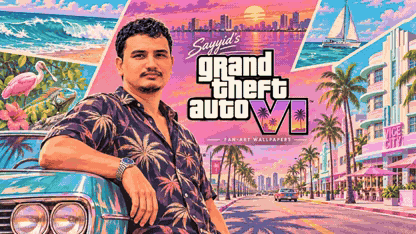

# Sayyid Edition

A GTA VI fan-art gallery featuring Sayyid Khan across 33 wallpapers. The Singapore Missions collection reimagines familiar places in Singapore, from a cockpit at Changi Airport to a night race at the Singapore Grand Prix.

[Live gallery](https://sayyid-vice-gallery.promptalchemistlabs.chatgpt.site/) · [Singapore Missions](https://sayyid-vice-gallery.promptalchemistlabs.chatgpt.site/#singapore-missions) · [Project repository](https://github.com/sayyidkhan/gta6-sayyid-vice-gallery)

| Vice City key art | Singapore Missions |
| --- | --- |
| [](dist/art/06-Custom-Vice-City-Cover.png) | [](dist/art/33-Last-Song-at-Koi-Club.png) |
| *Custom Vice City Cover* | *Last Song at Koi Club* |

## Browse and download

Choose a collection and open a wallpaper. Use the on-screen arrows or your keyboard’s left and right arrow keys to browse within that collection. Select **Download PNG** to save the current wallpaper, or **Download all** in the gallery header to save the full collection as a ZIP.

## Run locally

With Git and Python 3 installed, run:

```sh
git clone https://github.com/sayyidkhan/gta6-sayyid-vice-gallery.git
cd gta6-sayyid-vice-gallery
python3 -m http.server 8000 --directory dist
```

Open [localhost:8000](http://localhost:8000/). The gallery uses static HTML, CSS, and JavaScript and can be hosted by serving `dist/` as the site root.

## Project files

| Path | Contents |
| --- | --- |
| `dist/index.html` | Gallery layout, collection filters, and wallpaper viewer |
| `dist/gallery.js` | Artwork titles, categories, and image paths |
| `dist/art/` | Full-resolution PNG wallpapers and WebP thumbnails |
| `dist/archive.js` | Browser-side ZIP download logic and archive metadata |
| `dist/robots.txt` | Crawling rules for the public gallery |

The ZIP metadata corresponds to the exact PNG files in the collection. Refresh it when adding or replacing a wallpaper.

An unofficial fan project inspired by Rockstar Games’ *Grand Theft Auto VI*.
